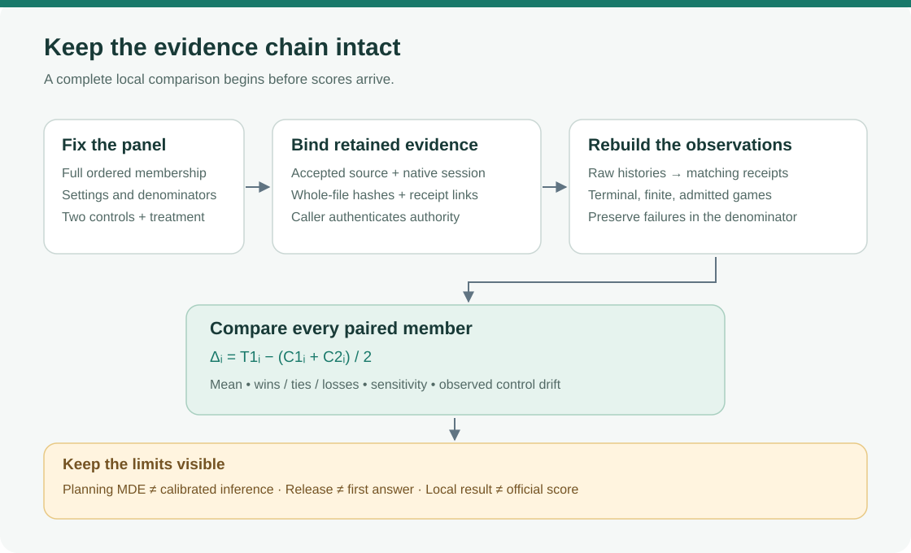

# A complete-panel comparison you can inspect

A treatment can look better when failed games disappear from the denominator. This small local tool keeps a registered panel intact, rebuilds each run's receipt from its raw action history, and compares one treatment with two controls. It runs with Python's standard library and never starts an agent, model, environment, accelerator, network request or subprocess.



## What it checks

The contract supplies the panel order, terminal states, source/native identity, runtime profile, expected settings and SHA256 pins for every retained input. The tool requires all panel members in the same order in all three runs, positive non-RESET activity, finite scores, consistent per-game level denominators and terminal raw histories. It checks source, accepted-version and native-session links; rebuilds action, token and admission counts; and compares the raw benchmark, receipt and root byte links. JSON duplicate keys and nonfinite constants fail closed. Output is created once, preserving previous results.

This is a validator of retained declarations and bytes. The caller must independently authenticate the accepted version, native session, dataset/model mounts and authority of the contract. Identical source hashes for two controls do not establish identical seeds or equivalent workloads. The optional runtime profile is a caller-supplied pin; a stricter real experiment should supply it.

The existing receipt schema uses the first `tokens=...` match in `solver_note`, or null when no match exists. The utility reproduces that observation and treats null as zero only when summing the note-token aggregate. Note-token counts and per-action generated-token counts remain distinct.

## Run an invented example

The test fixture contains a small, invented panel. Its empty source notebook is JSON data, and its claimed native bindings are deliberately invented; it is a mechanics demonstration.

```sh
python3 -B - <<'PYCODE'
import hashlib, json
from pathlib import Path
from test_analyze_panel import fixture
folder = Path("invented-demo")
folder.mkdir(exist_ok=False)
contract = fixture(folder.resolve())
raw = (json.dumps(contract, indent=2, sort_keys=True) + "\n").encode()
with (folder / "contract.json").open("xb") as stream:
    stream.write(raw)
print("Contract SHA256:", hashlib.sha256(raw).hexdigest())
PYCODE
```

Use the printed hash below. Choose a fresh output path for every analysis.

```sh
python3 -B analyze_panel.py \
  --contract invented-demo/contract.json \
  --contract-sha256 THE_PRINTED_SHA256 \
  --output invented-demo/analysis.json
```

Exit 0 means `PASS_LOCAL_COMPLETE_PANEL_ANALYSIS_ONLY`. Exit 2 means a contract/integrity hold; inspect the fixed failure code in the new JSON. An existing output remains intact and its create-only write fails. The CLI never publishes a result or changes a notebook.

For your own retained records, use the contract structure produced by `fixture()` in [test_analyze_panel.py](test_analyze_panel.py). Each file descriptor contains `path`, `sha256` and preferably `bytes`. Required run files are `binding`, `source`, `root`, `receipt` and `benchmark`; `report` is optional. A capture-qualified binding additionally needs `accepted_receipt`. The analyzer understands the declared session-receipt schemas shown in the fixture, rather than arbitrary third-party leaderboard formats.

## Read the comparison carefully

For game *i*, the paired contrast is `T1_i - (C1_i + C2_i)/2`. The output includes its mean, median, wins/ties/losses and leave-one-game-out mean range. Every registered member stays in the denominator. The range is a sensitivity check, not a confidence interval or permission to drop an inconvenient game.

The two-control difference also supplies a planning heuristic:

```text
A/A_i       = C2_i - C1_i
game term   = sqrt(0.75) * sample_sd(A/A) / sqrt(panel_size)
drift term  = sqrt(0.75) * abs(mean(A/A))
combined    = hypot(game term, drift term)
formula MDE = (z_alpha + z_power) * combined
```

Supply the constants from your preregistration for exact reproduction. The defaults are convenience values. Two sequential controls cannot identify a run-level variance distribution, and an observed drift is not a random-effects estimate. This MDE is a heuristic budget diagnostic, not a calibrated significance test, confidence interval, power guarantee or proof that the controls are exchangeable. Identical observed controls still leave `inferential_MDE_identified` false. Small continue/reject thresholds can be budget filters; scientific adoption needs a separately registered, adequately powered comparison.

## Timing, completeness and privacy

Release time, whole benchmark span, receipt time and cumulative history clocks answer different questions. The tool leaves `cold_first_answer_seconds` unknown and `isolated_game_cap_proved` false. A release gate does not measure the first usable answer; a cumulative history clock does not establish each game's isolated time allowance.

Optional reports are diagnostics. Their logged request counts are cross-checked internally; request-error counts remain observations, and transport thread labels are not game IDs. Report warnings, fallback entries, process-release fields and teardown declarations do not independently authenticate process ownership, prove final inactivity or admit a future native/hidden run. Complete records can still contain request errors or games that gave up.

**All real outputs remain private by default in your workflow.** Omitting `--private-rows` removes the per-game list, but aggregate measurements, panel hash, receipt hashes and opaque report values remain. It is not anonymization or publication clearance. The public validation file here contains invented controls only. Local visible-panel evidence is never an official competition score, hidden-game result, valid submission artifact or automatic promotion; `official_score` stays null and `strategy_adoption` stays `NO_AUTOMATIC_ADOPTION`.

## Validation and provenance

[PUBLIC_INVENTED_VALIDATION.json](PUBLIC_INVENTED_VALIDATION.json) records the retained chronology: eight methods passed normally and with `-O` before small schema hardening; one targeted method passed after that change; and four focused methods passed on the final reviewed source after corrections to note-token semantics, native identifiers and request diagnostics. The latter tests cover the full invented pipeline and the changed branches. We did not claim a repeated full final suite. The current test file has eleven methods and retains all its invented fixtures rather than cleaning them up.

To run the supplied controls on your own machine:

```sh
python3 -B -m unittest -v test_analyze_panel.py
python3 -B -O -m unittest -v test_analyze_panel.py
```

The code and diagram are original MIT-licensed work. The utility adopts the existing campaign receipt field contract and documents its heuristic contrast; it includes no vendor agent, model, benchmark environment, competition data, private native receipt or weights. Its license grants no rights to external models, datasets, or third-party campaign notebooks. See [PROVENANCE.json](PROVENANCE.json).
