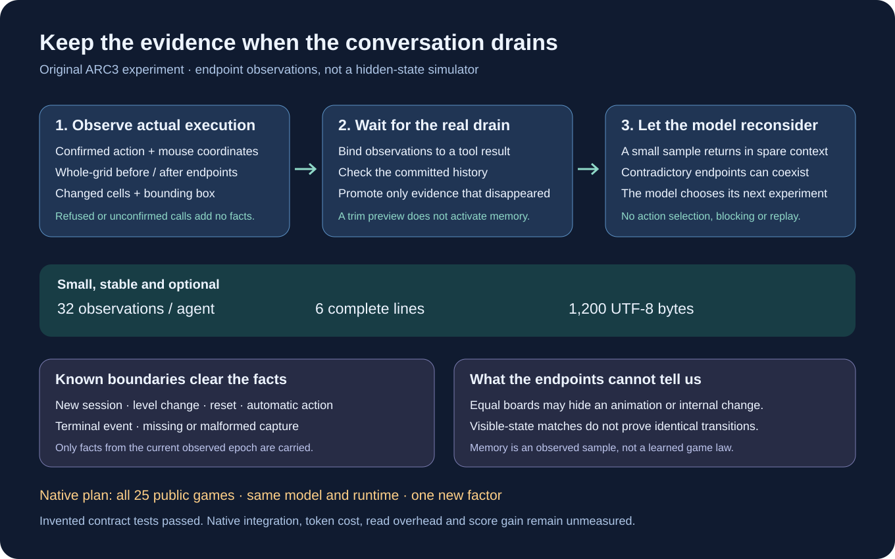

# Keep the experiment after the conversation forgets it

An ARC agent can inspect a board, try an action and correctly describe its result,
then lose that exchange when its conversation window drains. This original tool
keeps a small sample of those executed observations for the next request.

It records whole-grid endpoint hashes, action displays including mouse coordinates,
changed-cell counts and bounding boxes. It makes no claim about an animation it
did not capture, a hidden game state, or the best action. The model still chooses
what to try. A repeated visible board can produce different outcomes; both facts
can survive instead of being turned into a deterministic rule.



The bounds are deliberately small: 32 stored observations per agent, at most six
lines and 1,200 UTF-8 bytes in a request. The early two observations and latest
thirty remain eligible. A tool result must bind uniquely to its confirmed action
observations, and its message must actually disappear from committed history.
Previewing a trim does not activate memory. A reset, automatic action, terminal
event, level change, missing frame or new session clears the facts.

The optional `install()` adapter preserves the existing history-trimming algorithm
and uses the harness's existing input estimate to check spare space. If the new
block does not fit while leaving at least 512 estimated tokens unused, it is
omitted. This preserves the pinned harness's overflow retry reserve. This estimate is not exact tokenizer proof;
actual prompt usage, overflow, cache effects and observation-read overhead must
be measured in the native experiment. The adapter adds no model requests and
does not wrap the environment callback or alter action guards.

## Try the original primitive interface

```python
from evidence_memory import EvidenceMemory

memory = EvidenceMemory()
memory.sync(object(), 1)  # an opaque session identity and observed level
memory.observe(
    {"step": 0, "level": 1, "grid": [[0, 0], [0, 0]]},
    [{"action": "RIGHT", "frame": {"step": 1, "level": 1,
       "grid": [[0, 1], [0, 0]]}, "result": {"executed": True}}],
    confirmed=True, content="action executed",
)
tool_message = {"role": "tool", "tool_call_id": "example1",
                "content": "action executed"}
memory.bind(tool_message)
memory.commit([tool_message], [])
print(memory.block)
```

Run `python -B test_evidence_memory.py` for invented primitive and fake lifecycle
controls. These tests run no organizer games, models or third-party agent code.
The adapter accepts a caller-reviewed source SHA256 and refuses a mismatch.
The pin is a trust input; it does not authenticate a native run or license code.

## What this experiment can establish

The planned first screen uses all 25 public environments, one pass, ten concurrent
games and the same 2,200-second per-game cap as its controls. It changes only this
memory factor. Activation and bounded overhead come before any score comparison.
The earlier two identical control screens varied substantially: 44.238 and 35.882
local mean score. One positive screen cannot establish a durable gain.

No native execution or score improvement has been measured for this successor.
The public [Franzen Milestone 2 reference](https://www.kaggle.com/code/dfranzen/arc-agi-3-milestone-2-solution)
showed notebook-best metadata 34.30 when checked on October 11, 2026. Our exact
completed official result remained 30.65. Our retained reference and control use
the same harness patch and reasoning settings; that gap is not evidence of a
missing algorithm. Notebook-best metadata, local screens and exact completed
official rows are separate measurements.

This package contains original adapter code, tests and diagram only. The credited
Franzen/Tufa harness, Pennyroyal serving implementation and Qwen checkpoints keep
their separate provenance and terms. No third-party source, weights, game files,
native histories or private operational driver are included.
