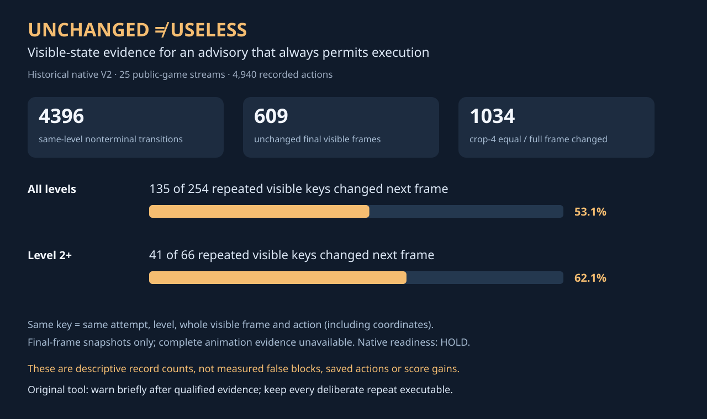

# A repeated frame is evidence, not a proof of a useless action



This small original experiment asks a practical question for interactive agents:
when an action leaves the screen unchanged, how much can we conclude? The answer
affects both action efficiency and the risk of getting stuck behind our own guard.

The supplied `RepeatAdviser` gives compact advice after repeated visible evidence.
It **always permits execution**. There is no action callback, refusal, replacement,
engine access or model call. A deliberate repeat can still discover a delayed or
unobserved effect. This is a proposed standalone component; it has not been
installed in a Kaggle notebook or evaluated as a game policy.

## What the recorded observations actually show

We audited 25 preserved public-game event streams from an older native run:
`prvsiyan/arc-agi-3-stock-taaf-action7-shadow`, Version 2, native script
`338356015`, completed on 28 July 2026. This run predates the current Franzen M2
recipe. Its scientific readiness decision was **HOLD**: among other issues, the
submission file was a one-row placeholder, logs contained failures/timeouts, and
the terminal source differed from its intended local candidate. Terminal kernel
completion does not make it a qualified competition result.

The retained post-action snapshots nevertheless provide a reproducible descriptive
test of visible-state assumptions. We exclude RESET, UNDO, terminal transitions,
level changes and missing predecessors. Frame equality includes every border and
HUD cell; action coordinates are part of the key. The preceding verdict is scoped
to the same attempt and level.

| Descriptive count | Recorded value |
|---|---:|
| Action records across 25 streams | 4,940 |
| Same-level nonterminal transitions after boundaries | 4,396 |
| Final visible frame unchanged | 609 |
| Revisited exact visible key after its preceding unchanged verdict | 254 |
| Those revisits followed by a changed final frame | 135 |
| Level 2+ revisits after an unchanged verdict | 66 |
| Those level 2+ revisits followed by a changed final frame | 41 |
| Hypothetical crop-4 equality while the whole frame changed | 1,034 |
| Complete intermediate animation chains available | 0 |

Here a key is `(level, whole visible frame, action)`. The counts do not prove why
the outcome varied. They do not identify a cooldown, hazard, hidden variable or
logging mechanism. They do show that treating a previous unchanged final frame
as a permanent action prohibition would be an unsupported assumption on these
recorded observations. The 135 revisits are **not** measured false blocks, saved
actions, avoided deaths or score gains. A blocked policy would produce a different
trajectory and would need its own actual game evaluation.

The crop-4 counter is a hypothetical diagnostic, not a recreation of every current
harness condition. Border changes can be HUD changes; they can also be useful
visible information. Our whole-frame key makes that choice conservative and
explicit. A timer that changes every action will reduce the usefulness of advice.

## Using the adviser from the public frame view

```python
from repeat_adviser import RepeatAdviser, grid_from_ascii

adviser = RepeatAdviser()  # scoped to one live game instance
before = grid_from_ascii(current_frame.ascii)
level_before = current_frame.level
note = adviser.advise(level=level_before, board=before, action="UP")
if note.warn:
    print(note.message)  # optional short annotation, not an action veto

# Execute the chosen action through your own authorized live interface.
# Capture `after` and the complete per-action animation chain, when available.
# Do not substitute the final frame alone for missing intermediate capture.
adviser.observe(
    level_before=level_before, before=before, action="UP",
    level_after=current_frame.level, after=after,
    animation_frames=complete_visible_frames_or_none,
    terminal=False,
)
```

The ASCII converter uses its own equality-only ordering of the public colour
legend. It does not need raw engine colour ids, environment internals, game IDs,
replay IDs, seeds, solutions or future observations. Only information already
visible to the live agent belongs in the adapter. Bind both levels, the final
frame and terminal markers to the actual observed transition in a real adapter;
the snippet illustrates the component contract rather than a harness installer.

The library's rules are deliberately small:

1. Learn only from at least two executions with an unchanged whole frame and a
   complete supplied animation chain whose frames are also unchanged. Missing
   intermediate capture never qualifies. The adapter must attest completeness;
   structural and endpoint validation cannot establish that omitted frames do
   not exist.
2. Announce at most once for a qualified key. Advice does not consume an in-game
   action and must not introduce an extra model turn before execution. Execution
   stays permitted, including a deliberate third repeat that makes progress.
3. Any contradictory visible outcome retires that key while retained in memory.
   RESET, observed recovery, terminal transitions and level changes clear the
   corresponding evidence. Keep one instance per game; there is no shared cache.
4. Expire evidence after 32 executed transitions by default and bound memory to
   512 keys. Inspection calls do not advance that clock. Capacity eviction can
   forget a contradiction; the advisory remains overridable even then.

## Reproduce the diagnostic and controls

Python 3.10+; standard library only. Retain input event streams; the tool never
modifies them. It accepts 1–32 JSONL files, caps each at 32 MiB and the aggregate
at 128 MiB, rejects duplicate streams/JSON keys, validates action ordering and
visible grids, and prints a JSON receipt. Use frozen, hash-pinned snapshots:
concurrent input replacement is outside this offline contract.

```bash
python -m unittest discover -p 'test_*.py'
python -O -m unittest discover -p 'test_*.py'
python audit_visible_repeats.py /path/to/frozen/*_events.jsonl > my-audit.json
python make_figure.py
```

The 36 controls include transient bounces, hidden delayed effects, same-level
reset, level changes, terminal transitions, mouse-coordinate distinctions,
contradictions, TTL, malformed frames, endpoint mismatch and accounting boundaries.
They are invented software checks. They are neither native game runs nor ARC
scores. The historical audit took about four CPU seconds in one bounded local
pass, with `nice +5` and a 90-second process CPU limit.

## What would justify adoption

First add an observed-transition adapter and verify that no action is withheld,
duplicated or reissued and no extra model turn is introduced. Record exact source,
dataset and model pins and validate the animation-capture completeness contract.
Then compare actual terminal games with matched initialization, quotas, model,
sampling, admission shape, order and cold/warm serving conditions. Report all
games, effective action counts, levels, generated tokens, teardown and exceptions.
Include an A/A control to measure ordinary run spread.

This component is a separate hypothesis from the existing E2 screen that jointly
enables no-op, death-repeat and board-dump guards. That screen must finish and be
interpreted under its own registered gates. A fixed-prompt serving replay is not
a paired terminal-game experiment. No leaderboard improvement is claimed here.
